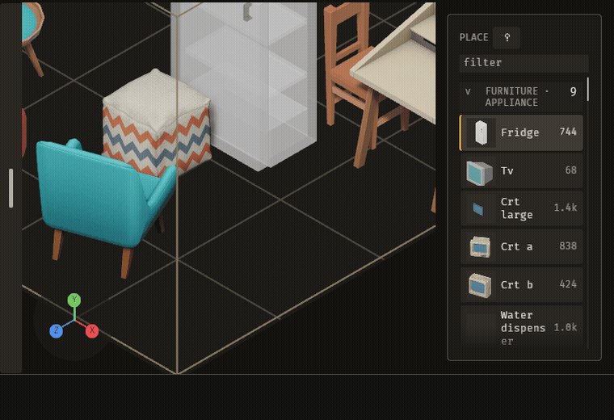
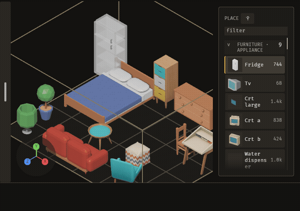

# Dark Factory: the Cauldron world editor (`bevy_dark_factory`)

> ⚠️ **Vibe Coded.** Written by AI agents working from a human's direction, covered by tests rather than a line-by-line human review. Read the code before you rely on it for something you care about.

The Dark Factory is a world editor for Bevy games, for developers who build levels with an AI agent working beside them. A person and the agent change the same map through the same named operations, and the editor writes the files your game loads.

[](https://crates.io/crates/bevy_grimoire) [](https://docs.rs/bevy_grimoire_core) [](https://github.com/dark-incorporated/bevy_dark_factory/actions/workflows/ci.yml) [](https://bevyengine.org) [](#who-and-licence)


*An agent calls `grimoire_apply_operation` twice, a removal and then a turn, and two presses of Cmd+Z (Ctrl+Z on Linux and Windows, as recorded here) take them back. Every change in the history list says who made it.*

**Status:** usable · Bevy 0.20 · MSRV 1.97.1 for the runtime crates · toolchain 1.98.1 (pinned in `rust-toolchain.toml`)

**Why:** an agent's change to a level is the same kind of change as yours, through the same named operations and into the same undo history, so you can let it build while you watch, cut out what is wrong and take back what you do not want. It is measured, too: `cauldron-bench` runs a real agent against a real editor and says whether a change made the agent better or worse.

**Names.** The editor is the Dark Factory (this repository, `bevy_dark_factory`). Its binary, its window and its crates still carry the earlier name, the Cauldron (`bevy_cauldron`), and what it writes and a game loads is still a grimoire (`bevy_grimoire`, `assets/grimoire/`). The agent is the Night Shift in Dark Inc.'s words and the Familiar in the editor's own.

## Quick start

```sh
git clone https://github.com/dark-incorporated/bevy_dark_factory
cd bevy_dark_factory
cargo run -p bevy_cauldron -- .
```

The editor opens a menu of the project's kits and maps; choose a map in the MAPS column. With no argument it opens the launcher instead: the projects you opened before, a folder to type, **Open example**, **New project…** and what the changelog added since you last looked. On your own game, pass its root instead of `.`; a project written before the YAML cutover is refused at open and `bevy_cauldron migrate <project folder>` moves it. [Getting started](https://github.com/dark-incorporated/bevy_dark_factory/blob/main/docs/guide/getting-started.md) walks through your first map.

**On a Mac with Apple Silicon**, download `Cauldron-<version>-macos-arm64.dmg` from the [releases](https://github.com/dark-incorporated/bevy_dark_factory/releases) and drag Cauldron into Applications: the same editor with every family crate built in, signed and notarized. The launcher offers **Update to v…** when a newer release exists. `tools/release/macos/build_app.sh` builds the same app locally.

**Let an agent drive the open editor** in one of two ways. In the editor's terminal (raise it with Cmd+J, Ctrl+J elsewhere), set Settings, Terminal, **Terminal agent** to Oh My Pi and press **Start agent**: it starts already connected, and an LED in the terminal's bar says whether it is live. Or add the MCP server to any MCP client while the editor runs:

```json
{ "mcpServers": { "bevy_grimoire": {
    "command": "cargo", "args": ["run", "-q", "-p", "bevy_cauldron_mcp", "--", "--project", "/path/to/project"],
    "cwd": "/path/to/bevy_dark_factory" } } }
```

**Load what the editor wrote in your game.** A game needs the runtime crate, and `GamePlugin` loads the project from the working directory (or from `GRIMOIRE_ROOT`):

```sh
cargo add bevy_grimoire
```

```rust,no_run
use bevy::prelude::*;
use bevy_grimoire::GamePlugin;

fn main() {
    App::new().add_plugins((DefaultPlugins, GamePlugin)).run();
}
```

[Your game](https://github.com/dark-incorporated/bevy_dark_factory/blob/main/docs/guide/your-game.md) covers loading one map by hand, live reload and baking a release. `games/sample/` is a small game made of YAML and Rhai whose Rust is exactly this.

## Try it

```sh
cargo run -p bevy_cauldron -- . bedroom --kit furniture
```

Opens the repository's own project on the one-room `bedroom` map and its `furniture` kit (`site` and `scp` are the other kits), which is the scene of the clips on this page. [The MCP tools](https://github.com/dark-incorporated/bevy_dark_factory/blob/main/docs/mcp-tools.md) list what an agent can call.


*The same window mid-clip. Every change in the history list says who made it.*

## What you can do

- **Build a map**: arm a piece, turn it, place it, fill an area, remove it and undo any of it: [building maps](https://github.com/dark-incorporated/bevy_dark_factory/blob/main/docs/guide/building-maps.md).

  

- **Work beside an agent**: it turns, removes, labels, frames and captures through the operations you use, shows its plan, hands each task back as a card you keep or undo in one click, and Cmd+\ cuts out a rectangle of the editor with a note it can read: [agents](https://github.com/dark-incorporated/bevy_dark_factory/blob/main/docs/guide/agents.md).

  

- **Write down a game's style, and have the agent follow it**: the Design workspace (Cmd+0) is the style as a tree of pages, one per place (the game, a region, a level, an area drawn on the map), each with a dream board of pictures. The agent reads a place's style with `grimoire_style` before it shapes the place, and its hand-back names the style lines it followed: [agents](https://github.com/dark-incorporated/bevy_dark_factory/blob/main/docs/guide/agents.md#the-games-style).

  

- **Work in one window**: ten workspaces from one key each (Project, Map, World, Kit, Animation, Sound, Files, Game, Agent and Design), a terminal under every screen (Cmd+J raises it), a finder for anything the project names (Cmd+P), Cmd+E for everything that happened with an Undo on the newest step, and three themes that recolour the editor live: [keys](https://github.com/dark-incorporated/bevy_dark_factory/blob/main/docs/guide/keys.md).
- **Make kits and labels**: bring in meshes, group them into kits and confirm the labels a vision model proposes: [kits and labels](https://github.com/dark-incorporated/bevy_dark_factory/blob/main/docs/guide/kits-and-labels.md).
- **Edit the files your game loads, live**: every project file is YAML, the editor re-reads a changed file within a quarter of a second, a running game can follow, and `bevy_cauldron bake` turns the data into a release: [data files](https://github.com/dark-incorporated/bevy_dark_factory/blob/main/docs/guide/data-files.md) and [your game](https://github.com/dark-incorporated/bevy_dark_factory/blob/main/docs/guide/your-game.md).
- **Measure the agent**: `cauldron-bench` gives an agent a task through the same MCP tools, grades the files it leaves and compares two runs with a paired interval; a release needs a run that is not worse than the last. On the sample game, an agent given `grimoire_style` satisfied all 24 of the style's lines and one without it 10.4 (30 scored runs, one model): [the benchmark](https://github.com/dark-incorporated/bevy_dark_factory/blob/main/bench/README.md) and [the study](https://github.com/dark-incorporated/bevy_dark_factory/blob/main/docs/research/2026-11-14-style-helps-an-agent-results-2.md).

## Part of Dark Inc.

The Dark Factory is the editor of [Dark Inc.](https://github.com/dark-incorporated): it takes each family crate as an optional cargo feature and edits that crate's own serde settings, so what it saves is what your game loads with the crate alone. [Using a crate with Grimoire](https://dark-incorporated.github.io/with-grimoire.html) in [the book](https://dark-incorporated.github.io/) explains the arrangement.

## The crates

| Crate | What it is |
|---|---|
| `bevy_cauldron` | The editor. Opens a project directory and writes the files a game loads. Not on crates.io: run it from a clone. |
| `bevy_cauldron_mcp` | The MCP server that gives an agent the editor's operations over stdio. |
| `bevy_cauldron_bench` | The benchmark runner and grader, `cauldron-bench`. |
| [`bevy_grimoire`](https://crates.io/crates/bevy_grimoire) | The runtime half: loads a project into a Bevy world (`GamePlugin`, `GrimoirePlugin`, `GrimoireLivePlugin`). |
| [`bevy_grimoire_core`](https://crates.io/crates/bevy_grimoire_core) | The engine-free core: the project's file types and YAML reader, the design tree, solvers, WFC (wave function collapse) and the grammar learner. |
| [`bevy_grimoire_solver`](https://crates.io/crates/bevy_grimoire_solver), [`_rng`](https://crates.io/crates/bevy_grimoire_rng), [`_anim`](https://crates.io/crates/bevy_grimoire_anim), [`_rhai`](https://crates.io/crates/bevy_grimoire_rhai), [`_snip`](https://crates.io/crates/bevy_grimoire_snip) | A deterministic SAT back-end, one ChaCha8 random stream, clip-weight blending, the Rhai script host, and cutting a rectangle out of a picture of the editor. |
| `bevy_grimoire_migrate`, `bevy_oracle`, `bevy_devshot` | The RON to YAML project migration, typed questions to a decision model, and a frame on demand as a PNG. Not on crates.io. |

A game depends on `bevy_grimoire` (and `bevy_grimoire_core` when it reads data without the engine). The crates were called `bevy_emerge_*` until 2026-10-31; those names have a final release that points here.

## Bevy compatibility

| Crate | Versions | Bevy |
|---|---|---|
| `bevy_grimoire` | 0.1 to 0.5 | 0.20 |
| `bevy_grimoire_anim` | 0.1 to 0.2 | 0.20 |
| `bevy_grimoire_rhai` | 0.1 | 0.20 |
| `bevy_grimoire_core`, `_solver`, `_rng`, `_snip` | every version | none: these crates have no Bevy dependency |

## Learn more

- [The guide](https://github.com/dark-incorporated/bevy_dark_factory/blob/main/docs/guide/README.md): every page, in reading order. The editor opens each from its Help menu.
- [The book page](https://dark-incorporated.github.io/crates/bevy_grimoire.html), with the 64-second demo, and [docs.rs/bevy_grimoire_core](https://docs.rs/bevy_grimoire_core).
- [MCP tools](https://github.com/dark-incorporated/bevy_dark_factory/blob/main/docs/mcp-tools.md), the [benchmark](https://github.com/dark-incorporated/bevy_dark_factory/blob/main/bench/README.md) and [`CHANGELOG.md`](https://github.com/dark-incorporated/bevy_dark_factory/blob/main/CHANGELOG.md) (every visible change has a clip).
- [What the project is, and what is wrong with it](https://github.com/dark-incorporated/bevy_dark_factory/blob/main/docs/PROJECT.md), and [the development loop](https://github.com/dark-incorporated/bevy_dark_factory/blob/main/docs/guide/loop.md): how changes are proposed, tested and reported.

## Who and licence

Maintained by [@Ladvien](https://github.com/Ladvien). Issues and pull requests are welcome at [github.com/dark-incorporated/bevy_dark_factory/issues](https://github.com/dark-incorporated/bevy_dark_factory/issues); a game asks for what it needs with the `consumer` label. Read the org's [CONTRIBUTING.md](https://github.com/dark-incorporated/.github/blob/main/CONTRIBUTING.md) and [`AGENTS.md`](https://github.com/dark-incorporated/bevy_dark_factory/blob/main/AGENTS.md) first, and run `cargo nextest run -p <crate>` for what you touched before you push.

MIT OR Apache-2.0, at your option.
