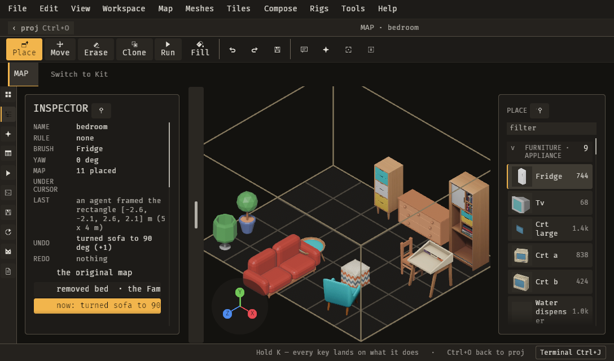

# bevy_dark_factory

> ⚠️ **Vibe Coded.** Written by AI agents working from a human's direction, covered by tests rather than a line-by-line human review. Read the code before you rely on it for something you care about.

The DarkFactory, a standalone world-building editor for Bevy games, for developers who build levels with an AI agent working beside them: open a project folder, author maps from a library of pieces, and save plain YAML that your game loads.


*A person snips part of the map and writes "remove the bed"; the agent reads the snip, removes the bed with `placement_remove`, and Ctrl+Z puts it back.*



**Status:** experimental · Bevy 0.20

**Why:** an agent's change is the same kind of change as yours, through the same named operations and in the same undo history, so you can let it build while you watch and take back what you do not want. The editor is a Bevy application in its own right, not a mode of a game.

## Quick start

`bevy_dark_factory` is not on crates.io (`publish = false`). From a clone of the [repository](https://github.com/dark-incorporated/bevy_dark_factory):

```sh
cargo run -p bevy_dark_factory -- <project-root>
```

`<project-root>` is your game's root, the folder that holds `assets/blueprint`. The repository's own example project is its root, so `cargo run -p bevy_dark_factory -- .` opens it, and `cargo run -p bevy_dark_factory -- . bedroom` goes straight to its one-room map.

**On a Mac with Apple Silicon**, the [releases](https://github.com/dark-incorporated/bevy_dark_factory/releases) carry `DarkFactory-<version>-macos-arm64.dmg`: the same editor with every family crate built in, signed with a Developer ID and notarized. The installed app checks the releases feed for a newer version and can update itself. The release workflow is [`release-macos.yml`](https://github.com/dark-incorporated/bevy_dark_factory/blob/main/.github/workflows/release-macos.yml).

With no argument the editor opens on the launcher. Its sidebar holds Projects, Learn and What's new, Settings, the version and the updater. Projects lists the projects you opened before, most recent first, as cards with a filter, and offers **New project** and **Open folder…**; on a first run it is a welcome with an **Open the example** button, which the Learn page also has. Opening a project starts the editor on it, in the same window.

```text
bevy_dark_factory [ROOT] [MAP] [--workspace <id>] [--kit NAME] [--live]
bevy_dark_factory migrate <project folder>
bevy_dark_factory bake <project folder> --out <folder>
bevy_dark_factory --print-operations
```

| argument | meaning |
|---|---|
| `ROOT`, `MAP` | the project's root (default: the current folder) and the map to open on the Map workspace; naming a map or a `--workspace` skips the launcher |
| `--workspace <id>` | open a workspace directly: `project`, `map`, `world`, `kit`, `animation`, `sound`, `files`, `game`, `agent` or `design` |
| `--kit NAME` | the kit to author in, when the project binds more than one |
| `--live` | write every committed change to disk at once, for a game that watches the project and reloads it |
| `migrate` | move a project's files from RON to YAML and exit, without opening the editor |
| `bake` | turn every YAML file a game loads into binaries for a release, proved against the YAML, and exit |
| `--print-operations` | print every operation this build has, one a line, and exit |

## What is in it

The editor has ten workspaces, one per job, and crossing between them keeps the project, the open map and the selection:

- **Map**: build the level from the library, placing, filling, turning and removing pieces, with undo.
- **World**: the terrain, water, forest and lights under the level.
- **Kit**: make reusable content, from meshes to tiles to compositions (named groups of placements a map refers to rather than copies).
- **Animation**: a rig bench that stages a figure through the real [`bevy_blueprint_anim`](https://crates.io/crates/bevy_blueprint_anim) blender.
- **Sound**, **Files** and **Game**: cue tables and scores, the project's files with an editor for each, and the running game beside its own window.
- **Agent** and **Design**: what the agent is doing and waiting on, and the game's style as a tree of pages with a dream board of pictures per place.
- **Project**: the project's maps and kits, the guide and what is new.

A terminal is docked across the bottom of every screen, already in the project's directory, and can start your agent already connected to the editor. Pressing `Cmd+\` (`Ctrl+\` elsewhere) snips a rectangle of the editor with a note the agent can read and see.

## Driving it from an agent

The default `debugger` feature serves the Bevy Remote Protocol (BRP, Bevy's JSON-over-HTTP interface) on `BEVY_BRP_PORT` (default 15702). The companion MCP server [`dark_factory_mcp`](https://github.com/dark-incorporated/bevy_dark_factory/blob/main/crates/dark_factory_mcp/README.md) speaks the Model Context Protocol on stdio and turns that into 28 typed tools; the same operations are what a key press runs.

```sh
cargo run -p bevy_dark_factory -- <project-root>                       # the editor
cargo run -p dark_factory_mcp -- --project <project-root>          # the server, for your MCP client
```

## Testable without a GPU

`harness::build_headless` builds the same plugin graph the binary ships, with `WgpuSettings { backends: None }` and no window, so tests can step frames and assert. That matters here because a missing `Res<T>` panics its system and no unit test could otherwise answer "does the editor survive its first frame". The example boots it:

```sh
cargo run -p bevy_dark_factory --example boot_headless -- <project-root> [map-name]
```

It needs a real project directory: nothing here invents one, so there is a single source of truth for what a project looks like.

## Learn more

- [Getting started](https://github.com/dark-incorporated/bevy_dark_factory/blob/main/docs/guide/getting-started.md) makes your first map; the rest of the [guide](https://github.com/dark-incorporated/bevy_dark_factory/blob/main/docs/guide/README.md): [building maps](https://github.com/dark-incorporated/bevy_dark_factory/blob/main/docs/guide/building-maps.md), [kits and labels](https://github.com/dark-incorporated/bevy_dark_factory/blob/main/docs/guide/kits-and-labels.md), [agents](https://github.com/dark-incorporated/bevy_dark_factory/blob/main/docs/guide/agents.md), [your game](https://github.com/dark-incorporated/bevy_dark_factory/blob/main/docs/guide/your-game.md), [keys](https://github.com/dark-incorporated/bevy_dark_factory/blob/main/docs/guide/keys.md), [data files](https://github.com/dark-incorporated/bevy_dark_factory/blob/main/docs/guide/data-files.md).
- [The MCP tool reference](https://github.com/dark-incorporated/bevy_dark_factory/blob/main/docs/mcp-tools.md), and [`guides/`](https://github.com/dark-incorporated/bevy_dark_factory/tree/main/crates/bevy_dark_factory/guides) for the scripted walkthroughs the editor can show.
- [Changelog](https://github.com/dark-incorporated/bevy_dark_factory/blob/main/CHANGELOG.md): what each change added, newest first.
- Part of Dark Inc.: the [family table](https://github.com/dark-incorporated) lists the other crates, and [the book page for this repository](https://dark-incorporated.github.io/crates/bevy_blueprint.html) says how they fit together. The game-side crates are [`bevy_blueprint`](https://crates.io/crates/bevy_blueprint) and [`blueprint_model`](https://crates.io/crates/blueprint_model).

## Who and licence

Maintained by [@Ladvien](https://github.com/Ladvien). Issues go to the [issue tracker](https://github.com/dark-incorporated/bevy_dark_factory/issues); see the organisation's [`CONTRIBUTING.md`](https://github.com/dark-incorporated/.github/blob/main/CONTRIBUTING.md).

MIT OR Apache-2.0, at your option: [`LICENSE-MIT`](https://github.com/dark-incorporated/bevy_dark_factory/blob/main/LICENSE-MIT) and [`LICENSE-APACHE`](https://github.com/dark-incorporated/bevy_dark_factory/blob/main/LICENSE-APACHE).
